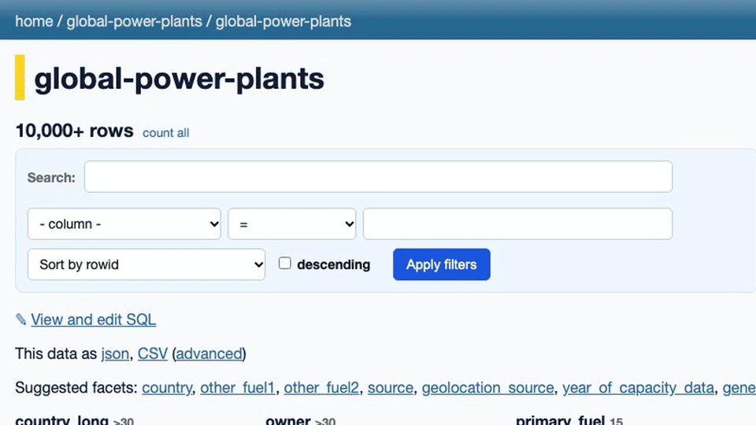
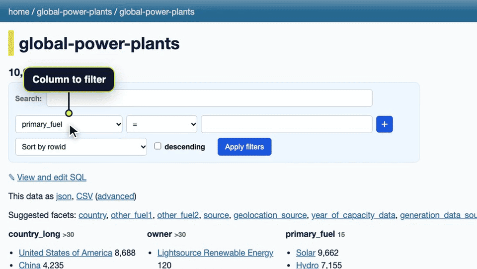
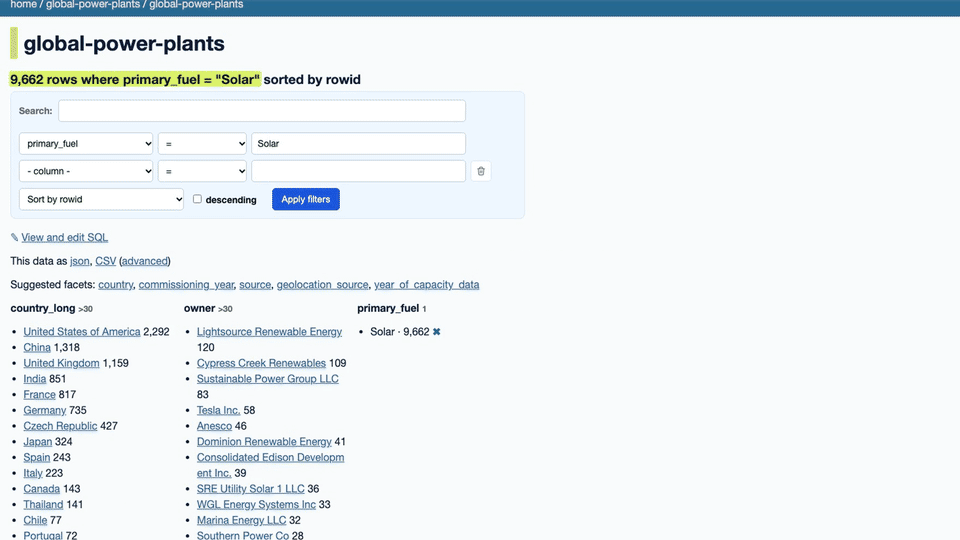
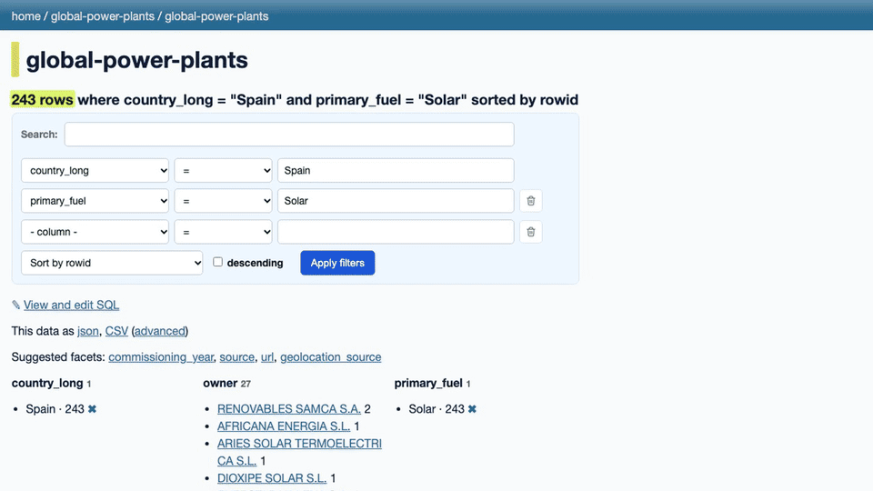
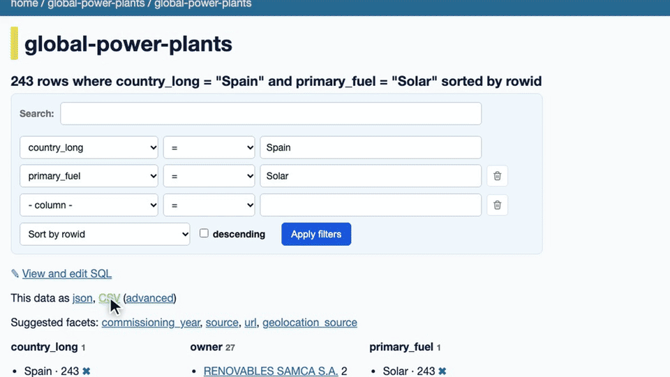

# Filter a table, add a facet and export CSV in Datasette

Narrow a large table down to the rows you need, then download exactly those rows as a CSV file.

1. **Pick the column to filter on**

   Open the table. In the filter box under the row count, open the "- column -" dropdown and choose the column you want to filter on, here "primary_fuel". Leave the operator on "=".

   

2. **Type a value and apply the filter**

   Type the value to match in the box next to the operator (values are case-sensitive, so type Solar, not solar) and click "Apply filters". The heading now says 9,662 rows where primary_fuel = Solar.

   

3. **Narrow it down with a facet**

   The facet lists below the filter count the values in the rows you are looking at. Under "country_long", click a country, for example "Spain". Datasette adds it as a second filter, so the table now shows only solar plants in Spain: 243 rows.

   

4. **Export the filtered rows as CSV**

   Next to "This data as", click "CSV". The link always carries your current filters, so the export contains exactly the 243 rows you see, with every column, not just the first page.

   

5. **Save the CSV as a file**

   The "CSV" link opens the data in the browser. To get a `.csv` file instead, click "advanced" next to it, tick "download file" under *Advanced export*, and click "Export CSV". Tick "stream all rows" as well if the filtered table has more than 1,000 rows.

   
