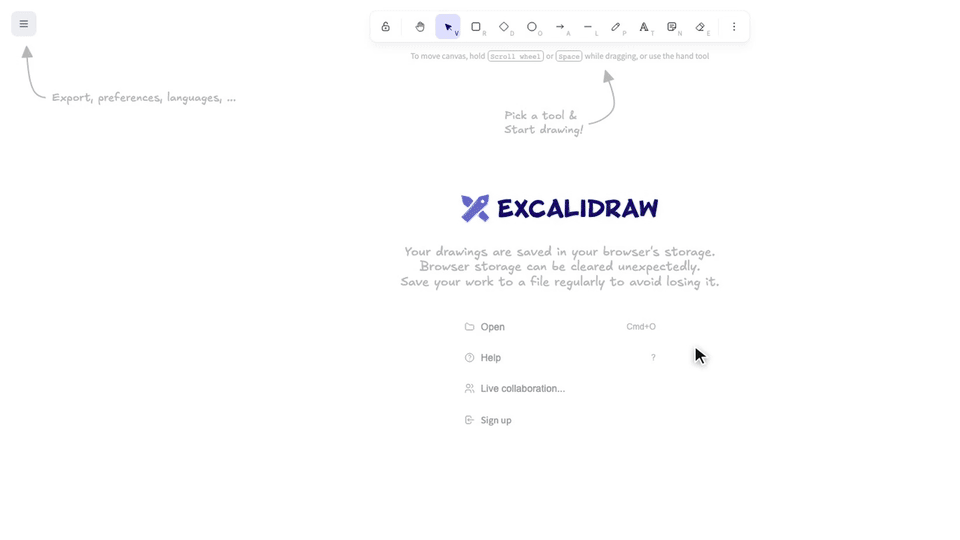
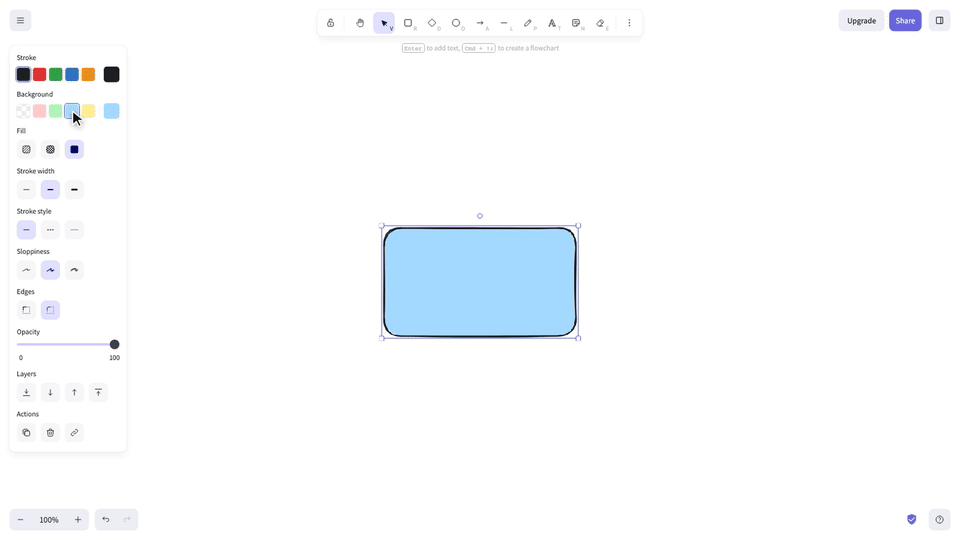
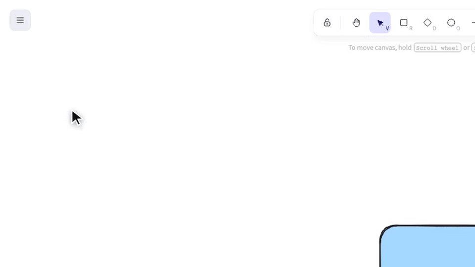
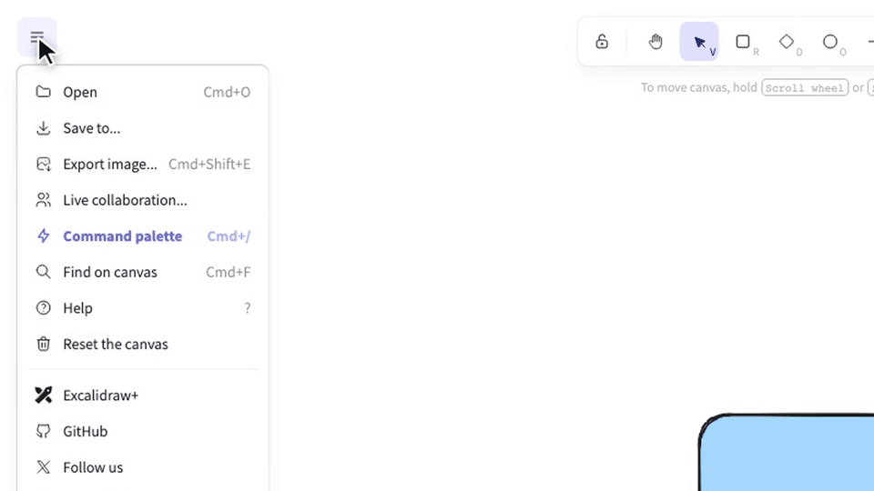
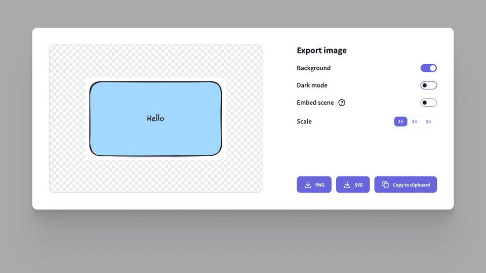
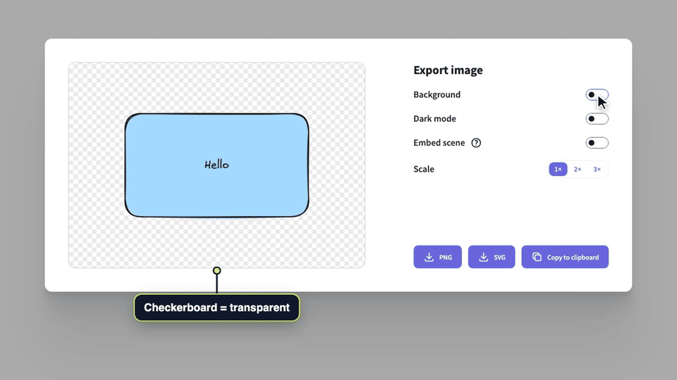
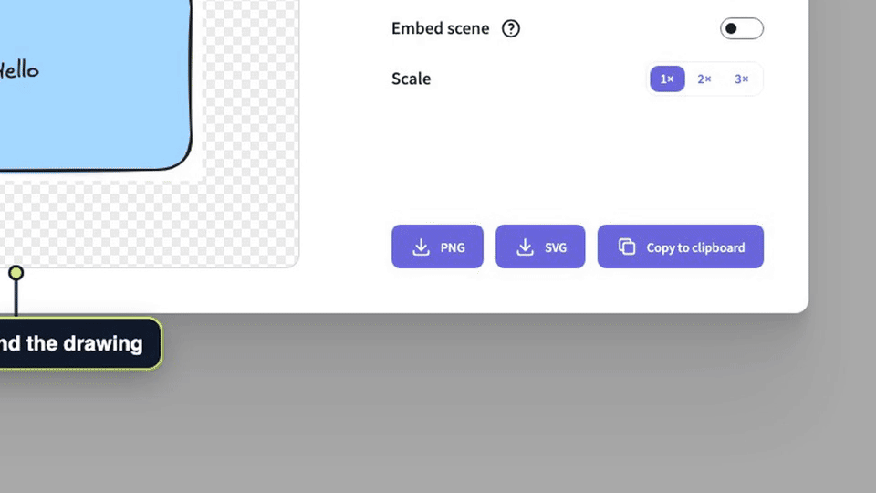
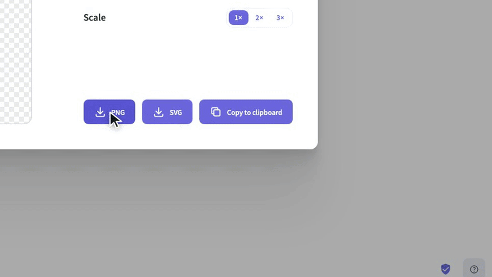

# Export a drawing as a PNG image

Save your Excalidraw drawing as a PNG file with a transparent or white background, or copy it to the clipboard to paste it anywhere.

1. **Draw a rectangle**

   Need something to export? Pick the **Rectangle** tool in the toolbar (or press R), drag on the canvas, and optionally pick a background color in the panel on the left.

   

2. **Add a label**

   With the rectangle selected, press Enter, type a label, then press Escape.

   

3. **Open the menu**

   Click the **menu** button in the top-left corner.

   

4. **Choose Export image**

   Choose **Export image...** (shortcut Cmd/Ctrl+Shift+E).

   

5. **Transparent background**

   Turn **Background** off to export with a transparent background. The checkerboard in the preview shows the transparent areas.

   

6. **White background**

   Turn **Background** back on to export on a solid white background (the canvas color).

   

7. **Download the PNG**

   Click **PNG** to save the image. Depending on your browser, it downloads straight away or asks where to save it. Tip — pick a **Scale** of 2× or 3× first for a sharper image.

   

8. **Copy to clipboard**

   Or click **Copy to clipboard** to put the PNG on your clipboard, then paste it straight into a doc, chat or email. The Background setting applies here too. Shortcut without opening the dialog — Shift+Alt+C copies the selected shapes as a PNG.

   
