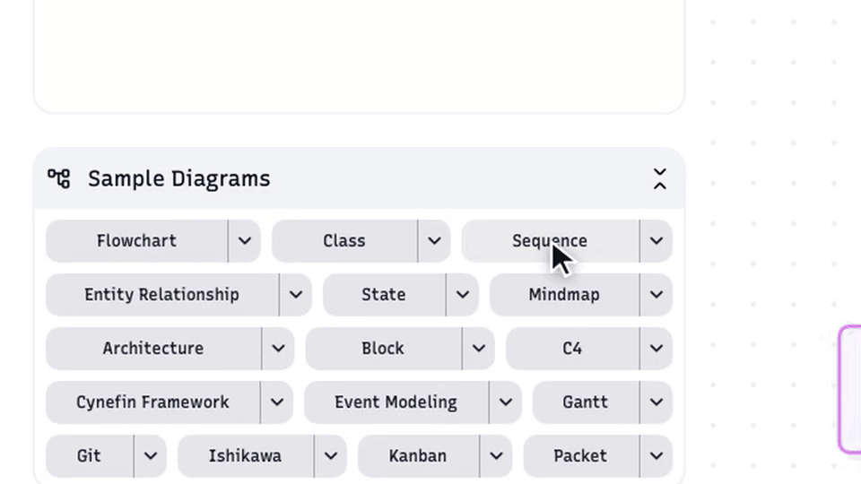
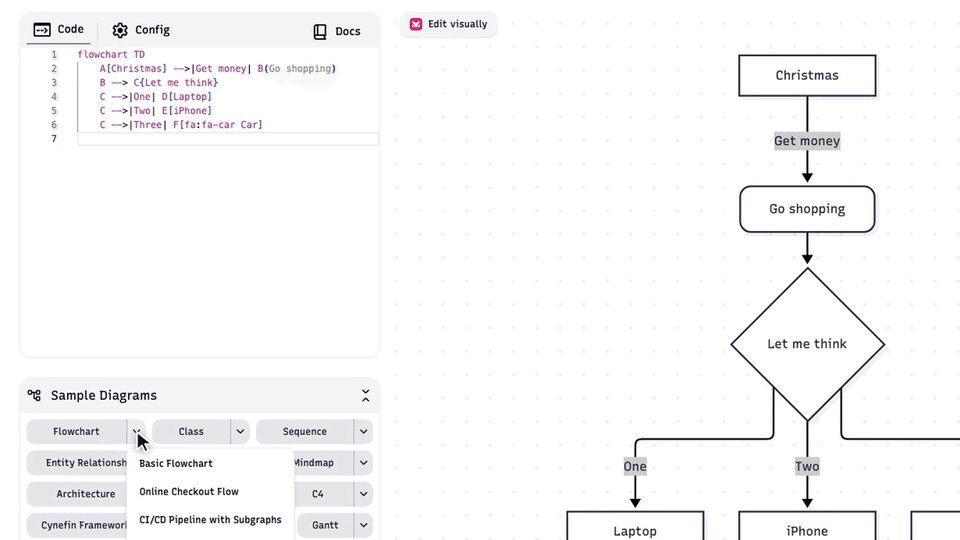
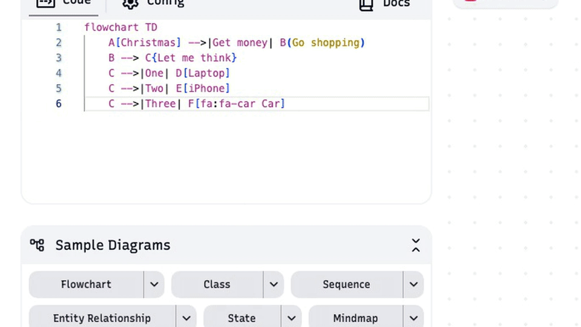
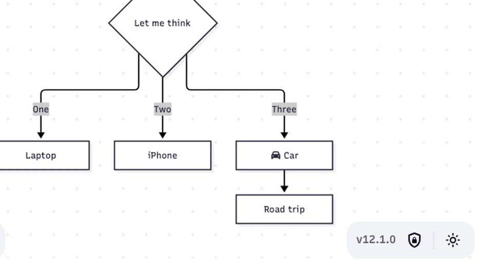
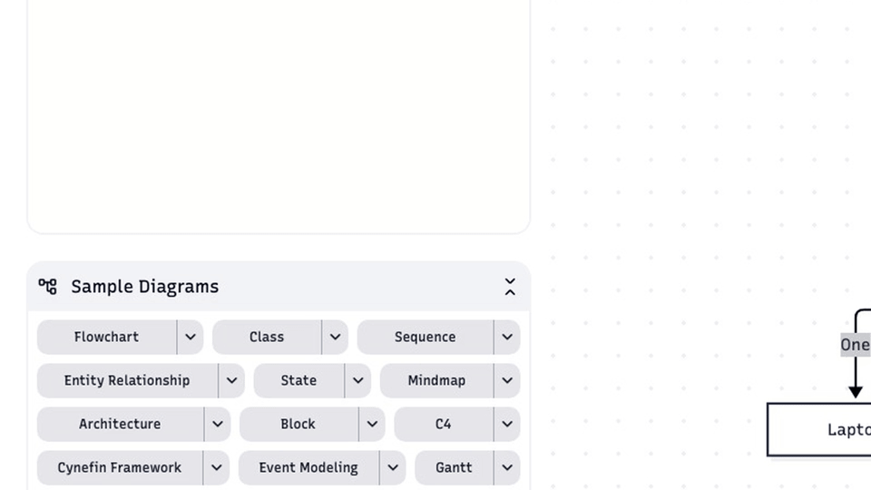
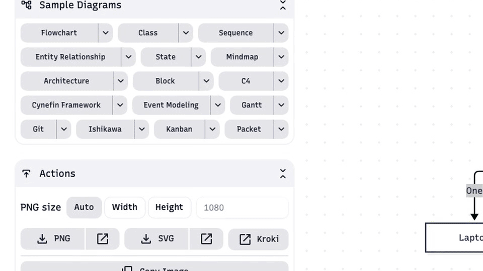
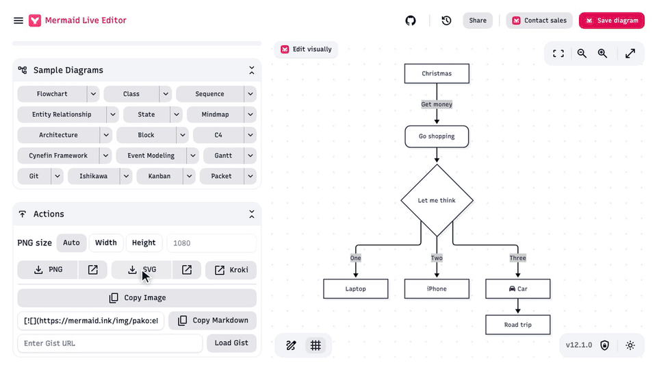

# Create, edit and export a flowchart in Mermaid Live Editor

Mermaid Live Editor (mermaid.live) turns a few lines of text into a diagram. This article shows how to start a flowchart from a built-in sample, add a node by editing the code, and download the result as an **SVG** or **PNG** file. You don't need an account.

1. **Open the Flowchart samples**

   In the **Sample Diagrams** panel (bottom left), click the arrow next to **Flowchart** to see the flowchart examples.

   

2. **Pick Basic Flowchart**

   Choose **Basic Flowchart**. The sequence diagram in the **Code** editor is replaced by the flowchart's Mermaid code, and the preview on the right redraws as a flowchart. Loading a sample replaces whatever is in the editor.

   

3. **Type a new line of code**

   Click in the **Code** editor, go to the end of the last line and press **Enter**. Type `F --> G[Road trip]`. `F` is the ID of the existing **Car** node, `-->` draws an arrow, and `G[Road trip]` creates a new node with ID `G` and the label *Road trip*.

   

4. **The new node appears**

   The preview redraws as you type, so the **Road trip** box appears under **Car** right away. If the preview shows a syntax error instead, check the line for a missing bracket or arrow.

   

5. **Open the Actions panel**

   Click **Actions** (bottom left) to show the export options.

   

6. **Download as SVG**

   Click **SVG** (the download arrow, not the open-in-new-tab icon next to it) to save the diagram as a scalable vector file, best for docs and slides. The browser confirms the download, and the file goes to your **Downloads** folder.

   

7. **Or download as PNG**

   For an image file, click **PNG** instead. **PNG size** is *Auto* by default; choose **Width** or **Height** and enter a number of pixels first if you need a specific size.

   
